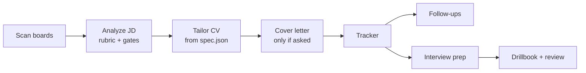

# jobsearch-harness

A job-search pipeline for Claude Code that works for any role and market. You describe yourself once in a `profile.yaml`; skills and scripts do the rest: scan job boards, score job descriptions against a rubric, tailor a CV and cover letter from a spec, track applications, nudge follow-ups, and prepare for interviews.

It ships **no personal data and no scrapers**. Your CV, knowledge base and tracker live in a private workspace you create; job boards plug in through a small adapter contract.

## How it works



| Stage | Skill | What it does |
|---|---|---|
| Setup | `init-workspace` | Interviews you, writes `profile.yaml`, creates the private workspace and tracker |
| Find | `job-scanner` | Searches the boards in your profile, triages, dedupes, proposes a priority table |
| Judge | `jd-analyzer` | Scores a JD (five weighted dimensions, pass/fail gates, posting health) |
| Apply | `cv-tailor`, `cover-letter-writer` | Builds the CV and letter from `spec.json`, verifies PDFs, never overwrites submitted files |
| Track | `followup-tracker`, `recruiter-responder` | Overdue follow-ups, recruiter replies |
| Prepare | `interview-prep`, `interview-drillbook`, `interview-material-reviewer` | Company prep, study book, factual review |
| Support | `human-text`, `save-context` | Natural-sounding text, persisting what you learn |

## Quickstart

```bash
git clone <this repository> && cd jobsearch-harness
python3 -m venv .venv && .venv/bin/pip install -r requirements.txt
```

Install it as a Claude Code plugin (this repo is its own marketplace):

```
/plugin marketplace add <path-or-url-of-this-repo>
/plugin install jobsearch-harness
```

Then, in a new empty folder outside this repository, ask Claude to run the **init-workspace** skill. It asks for your role, market, accepted locations, compensation floor and ask, languages and base CV, then creates the workspace. Validate it any time:

```bash
python3 scripts/jobprofile.py --workspace /path/to/workspace
```

Requires Python 3.9+. PDF builds need LibreOffice (`soffice`); the layout check also uses Poppler (`pdftotext`) when installed and is skipped without it. Everything else is pure Python.

## Customize

Everything personal or market-specific lives in `profile.yaml` (schema: `config/profile.schema.json`, example: `config/profile.example.yaml`).

- **Role presets** (`presets/roles/`): `frontend` and `generic` are complete; `backend`, `data`, `pm` are thin examples. A preset gives default roles, stacks, keywords and rubric wording; your profile always wins.
- **Market packs** (`presets/markets/`): `generic` has no country rules; `poland` adds contract-type and tax logic, boards and recruiter questions as an optional, informational pack. Add your own by copying `generic.yaml` and `generic.md`.
- **Scoring:** weights, thresholds and gates are configurable (`scoring`); the default rubric is five dimensions weighted 30/20/10/25/15 with gates for eligibility, language, location, employment type and a technical floor.
- **CV structure:** the builder finds sections by heading (`cv_map`); check with `python3 scripts/lib/cvbuild.py --map --workspace <dir>`.
- **Tracker:** columns, status names and colors can be overridden under `tracker`.

## Job boards (adapters)

The scanner never calls a named board. Each `boards` entry in your profile names an adapter that implements the search and get-details contract in [docs/adapters.md](docs/adapters.md). Write or install any MCP server or connector that follows it. A stub adapter in `tests/fixtures/demo/` shows the shapes. Respect each board's terms of service.

## Scripts

| Script | Purpose |
|---|---|
| `scripts/init_workspace.py` | Create a workspace from answers |
| `scripts/jobprofile.py` | Load, merge and validate `profile.yaml` (`--json` prints the merged profile) |
| `scripts/build_application.py` | Build CV/letter PDFs from `spec.json` (+ verification); DOCX-only with text checks when LibreOffice is missing |
| `scripts/verify_pdf.py`, `verify_layout.py` | ATS text-layer and layout checks |
| `scripts/tracker_query.py` | Fuzzy duplicate match, quiet follow-ups, conversion by score band |
| `scripts/restyle_tracker.py` | Sort, style and back up the tracker |
| `scripts/check_dm.py` | Check outbound LinkedIn DMs (sentence cap, banned phrases) |
| `scripts/netcalc.py` | Net-pay estimates from the market pack |
| `scripts/cleanup.py` | Dry-run-first removal of temp files |
| `scripts/privacy_audit.py` | Pre-push audit for this repository |

## Privacy and safety

- This repository contains no personal data. Your workspace does; keep it private, and keep `profile.yaml`, `cv_base/`, the tracker, knowledge base and backups out of any public repository.
- Job postings, aggregator pages and recruiter messages are treated as **untrusted input**: skills never follow instructions embedded in them (see the workspace `CLAUDE.md`).
- Tracker writes are backed up first; submitted CVs and letters are never overwritten without `--force`.
- Drafts only: the skills never send messages or submit applications for you.
- Tax and salary content is informational estimation, not advice.

## Development

```bash
.venv/bin/python -m pytest
.venv/bin/python scripts/privacy_audit.py
```

See [CONTRIBUTING.md](CONTRIBUTING.md). Licensed MIT; third-party attributions in [THIRD_PARTY_LICENSES.md](THIRD_PARTY_LICENSES.md).
